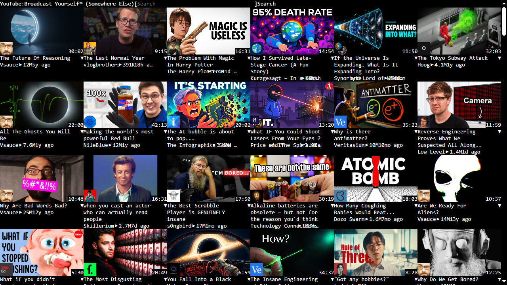
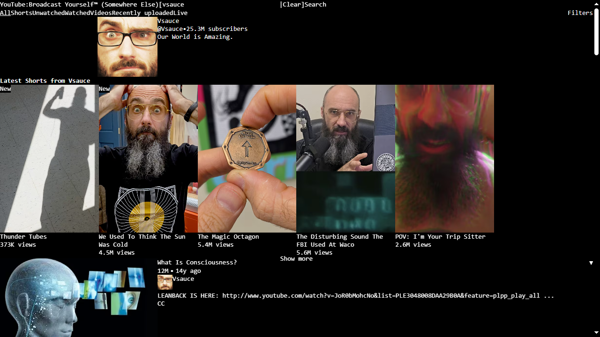
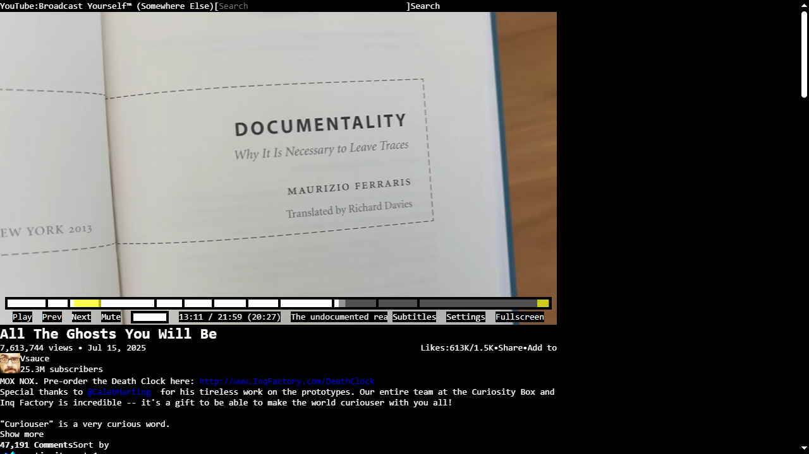
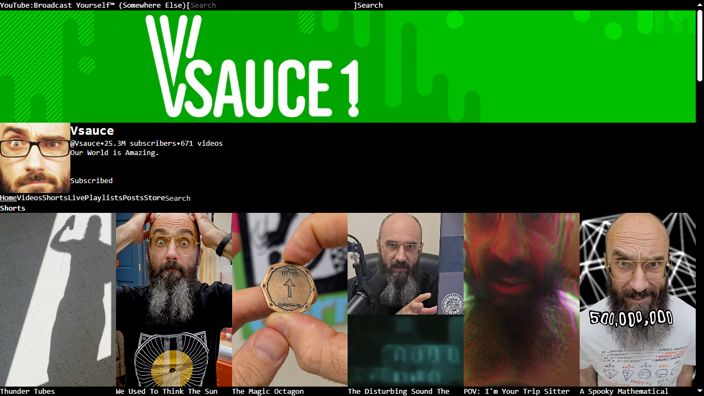
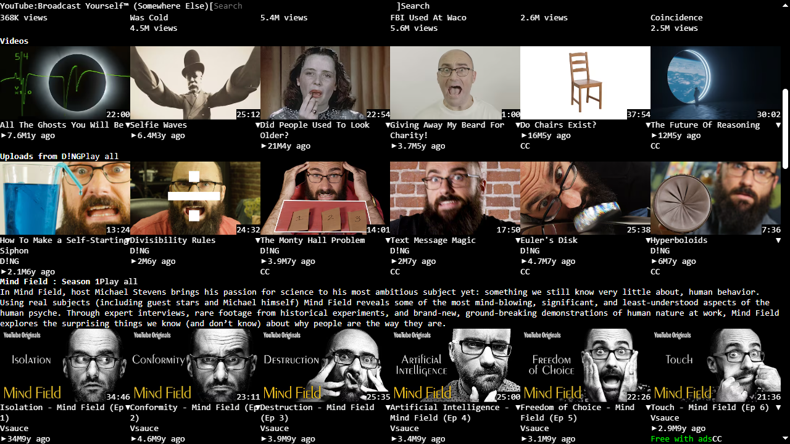
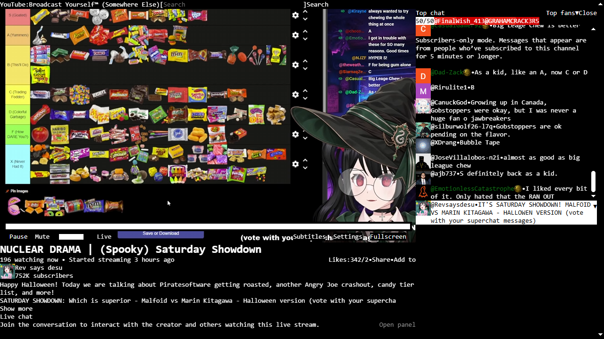

# Less than YouTube
A simple terminal-like YouTube Userstyle for non-logged in users 
[**Install**](https://github.com/Anomasho/Less-than-YouTube/raw/refs/heads/main/lessthanyoutubestylus.user.css)

## story
I don't like the YouTube's current layout and the userstyles that I found especially the ones that tried to mimic the old layout usually sucks or breaks when YouTube's layout change occurs and Vorapis v3 doesn't work properly for me without having an account log in and I'm using some other extensions that may not work properly for it so I ended up making a userstyle on my own.

## requirements (aka what i use for this)
- https://github.com/abhishekY495/localtube-manager
- https://github.com/Anarios/return-youtube-dislike
- https://github.com/tadwohlrapp/disable-youtube-autoplay
- https://greasyfork.org/en/scripts/500604-disable-drc-audio-on-youtube
- https://greasyfork.org/en/scripts/440613-youtube-proper-description
- https://greasyfork.org/en/scripts/553702-youtube-fullscreen-fix-disable-more-videos-grid-preserve-controls
- https://greasyfork.org/en/scripts/468740-restore-youtube-username-from-handle-to-custom

## screenshots

## known issue
- There may be some issues without LocalTube Manager
- Video player and some tweaks have some issues
- Some features like Shorts may be remained unfinished
- YouTube may update their layout that might ruin the looks of it
